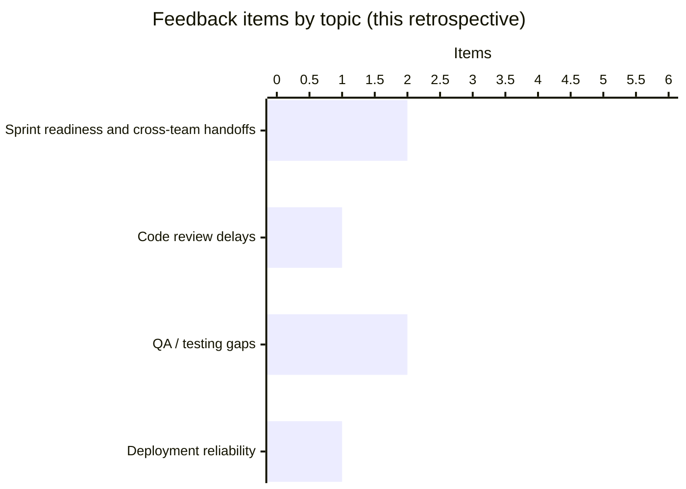
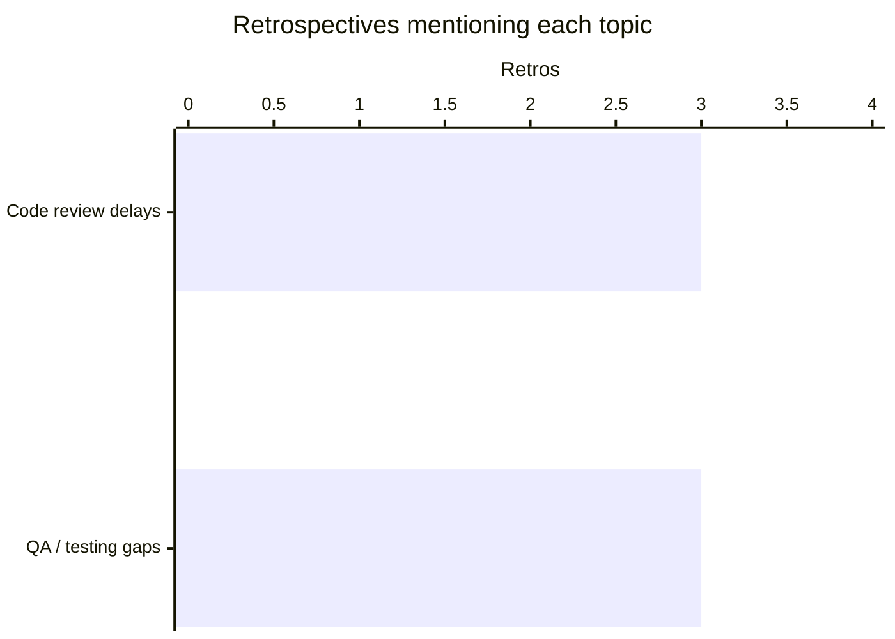

# Sprint 3 Retro Report

## Overview
- **Team:** Chartswap
- **Period:** Sprint 3
- **Status:** actioned
- **Generated:** 2026-10-14T12:35:21.707Z

## Participation
- Total feedback: 6
- Went well: 2
- Did not go well: 2
- Improvement ideas: 2

## Insights at a Glance

### Participation mix
| Category | Feedback items | Share |
| --- | ---: | ---: |
| Went well | 2 | 33% |
| Did not go well | 2 | 33% |
| Improvement ideas | 2 | 33% |

### Topic share (this retrospective)
| Topic | Feedback items | Share | Priority |
| --- | ---: | ---: | --- |
| Sprint readiness and cross-team handoffs | 2 | 33% | Medium |
| Code review delays | 1 | 17% | High |
| QA / testing gaps | 2 | 33% | High |
| Deployment reliability | 1 | 17% | Medium |

### Recurring across retrospectives
| Topic | Retros mentioned | Priority |
| --- | ---: | --- |
| Code review delays | 3 / 4 | High |
| QA / testing gaps | 3 / 4 | High |

_Disclaimer: Percentages are based on anonymous feedback items, not individuals._

## What Went Well
- (FB-0001) QA joined refinement and caught missing acceptance criteria early.
- (FB-0002) Handoffs between backend and frontend were smoother this sprint.

## Main Themes
- **Early quality involvement in planning** (FB-0001): The team noted that QA participation in refinement helped surface missing acceptance criteria before implementation work progressed.
- **Cross-team delivery handoffs** (FB-0002): A recurring positive theme is smoother coordination between backend and frontend during the sprint.
- **Code review throughput** (FB-0003): The team reported that the code review queue expanded again during the middle of the sprint.
- **Integration testing and regression risk** (FB-0004, FB-0005): Process feedback links a shipped regression to gaps in integration coverage, and the team explicitly called for broader integration tests around payment flows.
- **Deployment pipeline safeguards** (FB-0006): The team suggested strengthening the deployment path by automating configuration validation.

## Concerns
- (FB-0003) Mid-sprint growth in the code review queue was called out as a process pain point.
- (FB-0004) A regression reached production; the team attributed this in part to integration tests not covering the affected scenario.

## Improvement Opportunities
- (FB-0005) The team proposed expanding integration test coverage for payment flows.
- (FB-0006) The team proposed automating configuration validation in the deployment pipeline.

## Approved Actions
- **Cap the code review queue and agree first-response norms** (ACT-0001) — Teams: Dev Team, Management Team, Status: open
- **Expand regression and integration coverage in the delivery pipeline** (ACT-0002) — Teams: Dev Team, QA Team, Status: open
- **Add a pre-deploy deployment configuration validation step** (ACT-0003) — Teams: Ops Team, Dev Team, Status: open
- **Standardize refinement handoffs and keep QA involved early** (ACT-0004) — Teams: Product Team, QA Team, Dev Team, Status: open

## Previous Actions Follow-up
- Cap the code review queue and agree first-response norms (ACT-0001) from Sprint 3 Retro — open
- Expand regression and integration coverage in the delivery pipeline (ACT-0002) from Sprint 3 Retro — open
- Add a pre-deploy deployment configuration validation step (ACT-0003) from Sprint 3 Retro — open
- Standardize refinement handoffs and keep QA involved early (ACT-0004) from Sprint 3 Retro — open
- Adopt a 4-hour PR first-response target (ACT-0001) from Sprint 2 Retro — open
- Require acceptance criteria before sprint commitment (ACT-0002) from Sprint 2 Retro — open
- Run a post-deploy smoke test checklist (ACT-0003) from Sprint 2 Retro — open
- Schedule weekly pairing blocks for knowledge sharing (ACT-0004) from Sprint 2 Retro — open
- Hold a QA test-scope alignment at sprint start (ACT-0001) from Sprint 1 Retro — open
- Introduce a pre-handoff dev checklist before QA intake (ACT-0002) from Sprint 1 Retro — open
- Time-box daily sync to 25 minutes with a parking lot (ACT-0003) from Sprint 1 Retro — open
- Require two approving reviewers on pull requests (ACT-0004) from Sprint 1 Retro — open
- Document release-week collaboration practices for reuse (ACT-0005) from Sprint 1 Retro — open

## Observations Across Retrospectives
- Comparisons are descriptive observations, not proof of causality.
- Themes appearing in multiple retrospectives: Code review delays, QA / testing gaps, Long meetings / planning

## Limitations
- Anonymous feedback authors are never named in this report.
- Summaries are generated from stored feedback; they are not performance evaluations.
- Suggested actions require human review before approval.
- Analysis identifies process patterns, not individuals.
- Observations are not proof of causality.
- Anonymous submissions are not attributed to individuals.

## Generated Information
- Report generated deterministically from local files.
- Analysis source: cursor-agent
