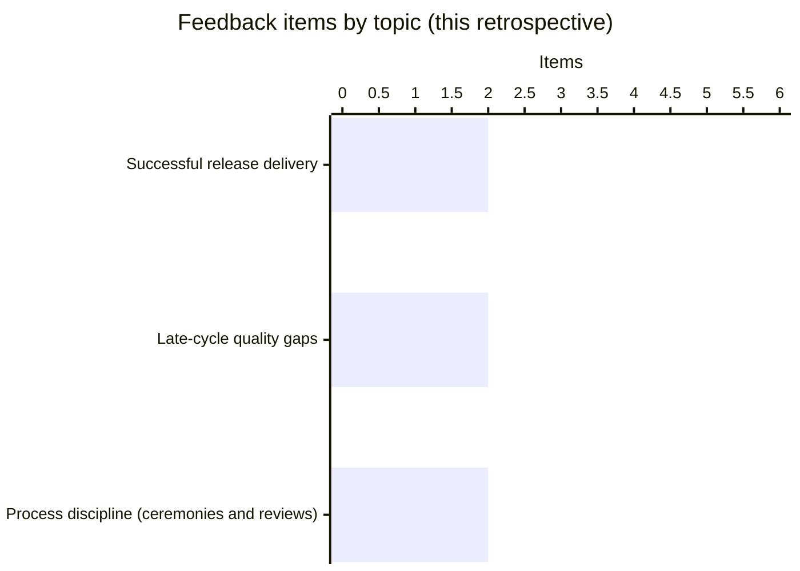
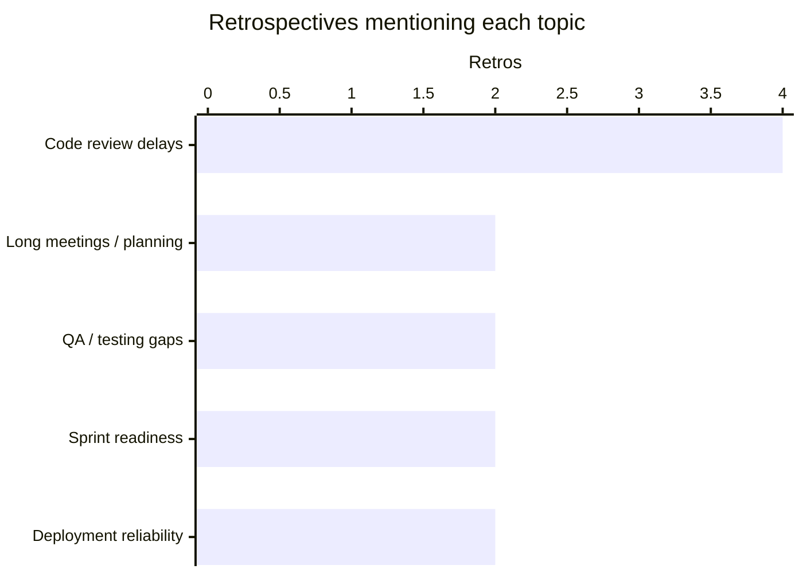

# Sprint 1 Retro Report

## Overview
- **Team:** Chartswap
- **Period:** Sprint 1
- **Status:** actions-sent
- **Generated:** 2026-11-20T17:28:52.510Z

## Participation
- Total feedback: 6
- Went well: 2
- Did not go well: 2
- Improvement ideas: 2

## Insights at a Glance

### Participation mix
| Category | Feedback items | Share |
| --- | ---: | ---: |
| Went well | 2 | 33% |
| Did not go well | 2 | 33% |
| Improvement ideas | 2 | 33% |

### Topic share (this retrospective)
| Topic | Feedback items | Share | Priority |
| --- | ---: | ---: | --- |
| Successful release delivery | 2 | 33% | Low |
| Late-cycle quality gaps | 2 | 33% | High |
| Process discipline (ceremonies and reviews) | 2 | 33% | Medium |

### Recurring across retrospectives
| Topic | Retros mentioned | Priority |
| --- | ---: | --- |
| Code review delays | 4 / 4 | High |
| Long meetings / planning | 2 / 4 | Medium |
| QA / testing gaps | 2 / 4 | High |
| Sprint readiness | 2 / 4 | Medium |
| Deployment reliability | 2 / 4 | Low |

_Disclaimer: Percentages are based on anonymous feedback items, not individuals._

## What Went Well
- (FB-0001) Strong team collaboration during release week.
- (FB-0002) We delivered the milestone on the planned date.

## Main Themes
- **Successful release delivery** (FB-0001, FB-0002): The team reported strong collaboration during release week and delivered the milestone on the planned date.
- **Late-cycle quality gaps** (FB-0003, FB-0005): A recurring concern is that many bugs reached QA late in the sprint; feedback also points toward earlier QA alignment on test scope before formal testing.
- **Process discipline (ceremonies and reviews)** (FB-0004, FB-0006): Daily syncs frequently ran over schedule, and the team raised ideas to tighten pull-request review before merge.

## Concerns
- (FB-0003) A large number of bugs escaped to QA late in the sprint.
- (FB-0004) Daily sync meetings often ran over the scheduled time.

## Improvement Opportunities
- (FB-0005) The team sees value in aligning with QA on test scope before formal testing starts.
- (FB-0006) The team suggested that pull requests require two reviewers before merge.

## Approved Actions
- **Add mid-sprint dev–QA test-scope sync** (ACT-0001) — Teams: Dev Team, QA Team, Product Team, Status: open, Lineage: SUG-001 · from FB-0003, FB-0005
- **Require two reviewers on every release-path PR** (ACT-0002) — Teams: Dev Team, Status: open, Lineage: SUG-002 · from FB-0006
- **Timebox daily standups to 15 minutes** (ACT-0003) — Teams: Dev Team, Management Team, Status: open, Lineage: SUG-003 · from FB-0004
- **Introduce a pre-QA merge checklist** (ACT-0004) — Teams: Dev Team, QA Team, Status: open, Lineage: SUG-004 · from FB-0003
- **Align acceptance criteria with QA during sprint planning** (ACT-0005) — Teams: QA Team, Product Team, Status: open, Lineage: SUG-005 · from FB-0005
- **Document what worked in the recent release** (ACT-0006) — Teams: Dev Team, Ops Team, Status: open, Lineage: SUG-006 · from FB-0001, FB-0002

## Stale Open Actions
_No open actions older than 14 days._

## Previous Actions Follow-up
- Add mid-sprint dev–QA test-scope sync (ACT-0001) from Sprint 1 Retro — open
- Require two reviewers on every release-path PR (ACT-0002) from Sprint 1 Retro — open
- Timebox daily standups to 15 minutes (ACT-0003) from Sprint 1 Retro — open
- Introduce a pre-QA merge checklist (ACT-0004) from Sprint 1 Retro — open
- Align acceptance criteria with QA during sprint planning (ACT-0005) from Sprint 1 Retro — open
- Document what worked in the recent release (ACT-0006) from Sprint 1 Retro — open

## Observations Across Retrospectives
- Comparisons are descriptive observations, not proof of causality.
- Themes appearing in multiple retrospectives: Code review delays, Long meetings / planning, QA / testing gaps, Sprint readiness, Deployment reliability

## Limitations
- Anonymous feedback authors are never named in this report.
- Summaries are generated from stored feedback; they are not performance evaluations.
- Human review is required before any suggested action is approved.
- Analysis identifies process patterns, not individuals.
- Observations are not proof of causality.
- Six anonymous items may not represent the full team experience for Sprint 1.

## Generated Information
- Report generated deterministically from local files.
- Analysis source: cursor-agent
