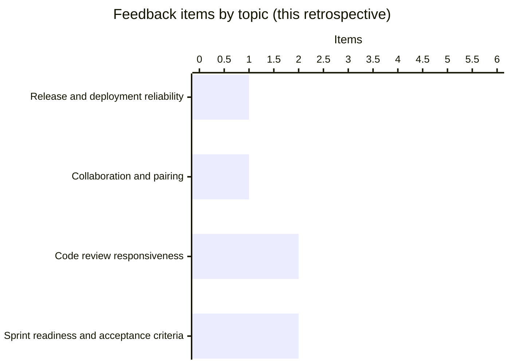
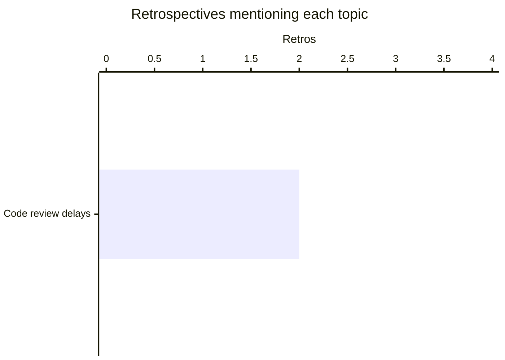

# Sprint 2 Retro Report

## Overview
- **Team:** Chartswap
- **Period:** Sprint 2
- **Status:** actioned
- **Generated:** 2026-10-10T14:07:10.965Z

## Participation
- Total feedback: 6
- Went well: 2
- Did not go well: 2
- Improvement ideas: 2

## Insights at a Glance

### Participation mix
| Category | Feedback items | Share |
| --- | ---: | ---: |
| Went well | 2 | 33% |
| Did not go well | 2 | 33% |
| Improvement ideas | 2 | 33% |

### Topic share (this retrospective)
| Topic | Feedback items | Share | Priority |
| --- | ---: | ---: | --- |
| Release and deployment reliability | 1 | 17% | Medium |
| Collaboration and pairing | 1 | 17% | Low |
| Code review responsiveness | 2 | 33% | High |
| Sprint readiness and acceptance criteria | 2 | 33% | High |

### Recurring across retrospectives
| Topic | Retros mentioned | Priority |
| --- | ---: | --- |
| Code review delays | 2 / 4 | High |

_Disclaimer: Percentages are based on anonymous feedback items, not individuals._

## What Went Well
- (FB-0001) The deployment pipeline was stable across all releases.
- (FB-0002) Pair programming helped us finish the API migration faster.

## Main Themes
- **Release and deployment reliability** (FB-0001): The team reported that the deployment pipeline remained stable across all releases during the sprint.
- **Collaboration and pairing** (FB-0002): Pair programming was cited as helping the team complete the API migration more quickly.
- **Code review responsiveness** (FB-0003, FB-0005): Pull request reviews experienced multi-day idle periods; the team suggested a first-response target for reviews.
- **Sprint readiness and acceptance criteria** (FB-0004, FB-0006): Stories entered the sprint without clear acceptance criteria; the team proposed a readiness checklist before sprint entry.

## Concerns
- (FB-0003) Code reviews sat idle for days before anyone responded.
- (FB-0004) Two stories entered the sprint without clear acceptance criteria.

## Improvement Opportunities
- (FB-0005) Define a first-response target for pull request reviews.
- (FB-0006) Add a readiness checklist before stories enter the sprint.

## Approved Actions
- **Adopt a 4-hour PR first-response target** (ACT-0001) — Teams: Dev Team, Status: open
- **Require acceptance criteria before sprint commitment** (ACT-0002) — Teams: Product Team, QA Team, Status: open
- **Run a post-deploy smoke test checklist** (ACT-0003) — Teams: Ops Team, Dev Team, Status: open
- **Schedule weekly pairing blocks for knowledge sharing** (ACT-0004) — Teams: Dev Team, Status: open

## Previous Actions Follow-up
- Adopt a 4-hour PR first-response target (ACT-0001) from Sprint 2 Retro — open
- Require acceptance criteria before sprint commitment (ACT-0002) from Sprint 2 Retro — open
- Run a post-deploy smoke test checklist (ACT-0003) from Sprint 2 Retro — open
- Schedule weekly pairing blocks for knowledge sharing (ACT-0004) from Sprint 2 Retro — open
- Hold a QA test-scope alignment at sprint start (ACT-0001) from Sprint 1 Retro — open
- Introduce a pre-handoff dev checklist before QA intake (ACT-0002) from Sprint 1 Retro — open
- Time-box daily sync to 25 minutes with a parking lot (ACT-0003) from Sprint 1 Retro — open
- Require two approving reviewers on pull requests (ACT-0004) from Sprint 1 Retro — open
- Document release-week collaboration practices for reuse (ACT-0005) from Sprint 1 Retro — open

## Observations Across Retrospectives
- Comparisons are descriptive observations, not proof of causality.
- Themes appearing in multiple retrospectives: Code review delays, QA / testing gaps, Long meetings / planning

## Limitations
- Anonymous feedback authors are never named in this report.
- Summaries are generated from stored feedback; they are not performance evaluations.
- Suggested actions require human review before approval.
- Analysis identifies process patterns, not individuals.
- Observations are not proof of causality.

## Generated Information
- Report generated deterministically from local files.
- Analysis source: cursor-agent
