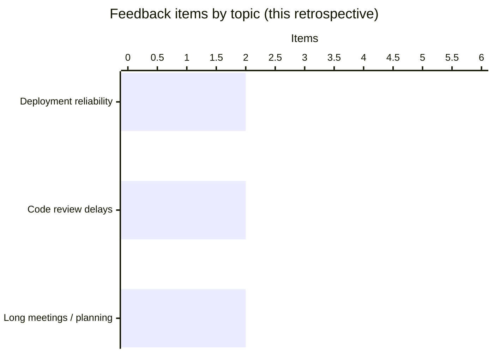
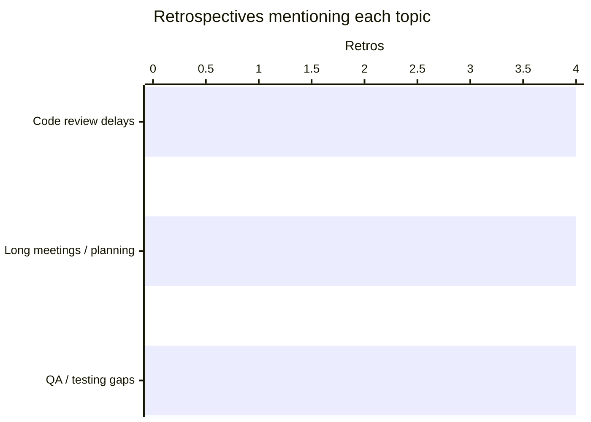

# Sprint 4 Retro Report

## Overview
- **Team:** Chartswap
- **Period:** Sprint 4
- **Status:** actioned
- **Generated:** 2026-10-24T20:22:30.106Z

## Participation
- Total feedback: 6
- Went well: 2
- Did not go well: 2
- Improvement ideas: 2

## Insights at a Glance

### Participation mix
| Category | Feedback items | Share |
| --- | ---: | ---: |
| Went well | 2 | 33% |
| Did not go well | 2 | 33% |
| Improvement ideas | 2 | 33% |

### Topic share (this retrospective)
| Topic | Feedback items | Share | Priority |
| --- | ---: | ---: | --- |
| Deployment reliability | 2 | 33% | Low |
| Code review delays | 2 | 33% | High |
| Long meetings / planning | 2 | 33% | High |

### Recurring across retrospectives
| Topic | Retros mentioned | Priority |
| --- | ---: | --- |
| Code review delays | 4 / 4 | High |
| Long meetings / planning | 4 / 4 | Medium |
| QA / testing gaps | 4 / 4 | High |

_Disclaimer: Percentages are based on anonymous feedback items, not individuals._

## What Went Well
- (FB-0001) Production releases remained reliable with no rollback.
- (FB-0002) The team rallied quickly when a customer escalation landed.

## Main Themes
- **Release reliability and incident response** (FB-0001, FB-0002): The team reported dependable production releases with no rollbacks and coordinated quickly when a customer escalation arrived.
- **Code review turnaround** (FB-0003, FB-0005): Review turnaround remains a bottleneck for urgent fixes; the team wants consistent two-reviewer practice from earlier retros.
- **Sprint planning efficiency** (FB-0004, FB-0006): Planning sessions exceed ninety minutes; the team proposed time-boxing and async status notes.

## Concerns
- (FB-0003) Review turnaround is still too slow for urgent fixes.
- (FB-0004) Sprint planning sessions routinely exceed ninety minutes.

## Improvement Opportunities
- (FB-0005) Enforce the two-reviewer policy discussed in earlier retrospectives.
- (FB-0006) Time-box planning and replace status updates with async notes.

## Approved Actions
- **Define a release readiness checklist with automated pre-deploy gates** (ACT-0001) — Teams: Dev Team, QA Team, Ops Team, Status: open
- **Agree an urgent PR first-response SLA and escalation path** (ACT-0002) — Teams: Dev Team, Management Team, Status: open
- **Pilot two-reviewer policy exceptions for labeled hotfix PRs** (ACT-0003) — Teams: Dev Team, Management Team, Status: open
- **Timebox planning sessions and require async pre-reads plus decision logs** (ACT-0004) — Teams: Product Team, Management Team, Status: open

## Previous Actions Follow-up
- Define a release readiness checklist with automated pre-deploy gates (ACT-0001) from Sprint 4 Retro — open
- Agree an urgent PR first-response SLA and escalation path (ACT-0002) from Sprint 4 Retro — open
- Pilot two-reviewer policy exceptions for labeled hotfix PRs (ACT-0003) from Sprint 4 Retro — open
- Timebox planning sessions and require async pre-reads plus decision logs (ACT-0004) from Sprint 4 Retro — open
- Cap the code review queue and agree first-response norms (ACT-0001) from Sprint 3 Retro — open
- Expand regression and integration coverage in the delivery pipeline (ACT-0002) from Sprint 3 Retro — open
- Add a pre-deploy deployment configuration validation step (ACT-0003) from Sprint 3 Retro — open
- Standardize refinement handoffs and keep QA involved early (ACT-0004) from Sprint 3 Retro — open
- Adopt a 4-hour PR first-response target (ACT-0001) from Sprint 2 Retro — open
- Require acceptance criteria before sprint commitment (ACT-0002) from Sprint 2 Retro — open
- Run a post-deploy smoke test checklist (ACT-0003) from Sprint 2 Retro — open
- Schedule weekly pairing blocks for knowledge sharing (ACT-0004) from Sprint 2 Retro — open
- Hold a QA test-scope alignment at sprint start (ACT-0001) from Sprint 1 Retro — open
- Introduce a pre-handoff dev checklist before QA intake (ACT-0002) from Sprint 1 Retro — open
- Time-box daily sync to 25 minutes with a parking lot (ACT-0003) from Sprint 1 Retro — open
- Require two approving reviewers on pull requests (ACT-0004) from Sprint 1 Retro — open
- Document release-week collaboration practices for reuse (ACT-0005) from Sprint 1 Retro — open

## Observations Across Retrospectives
- Comparisons are descriptive observations, not proof of causality.
- Themes appearing in multiple retrospectives: Code review delays, QA / testing gaps, Long meetings / planning

## Limitations
- Anonymous feedback authors are never named in this report.
- Summaries are generated from stored feedback; they are not performance evaluations.
- Suggested actions require human review before approval.
- Analysis identifies process patterns, not individuals.
- Observations are not proof of causality.
- Anonymous submissions are not attributed to individuals.

## Generated Information
- Report generated deterministically from local files.
- Analysis source: cursor-agent
